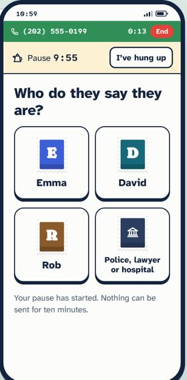
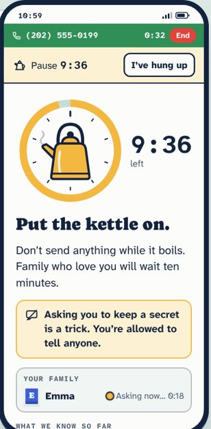
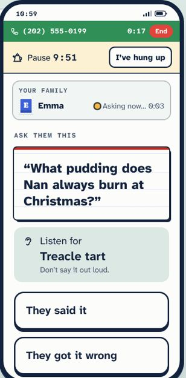
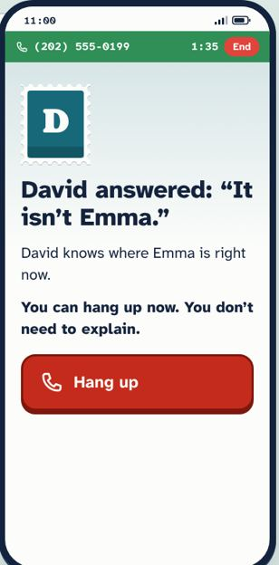
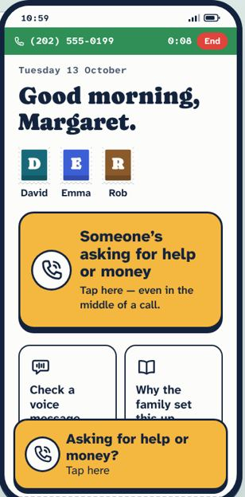
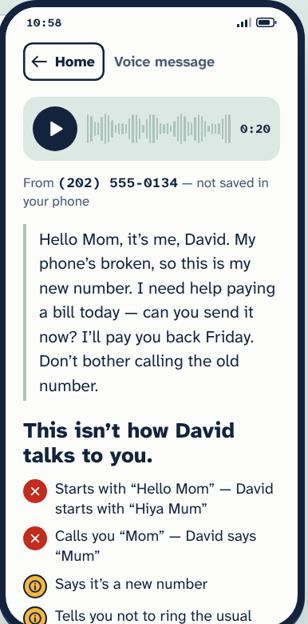
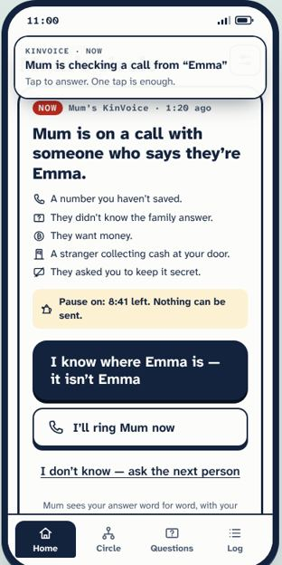
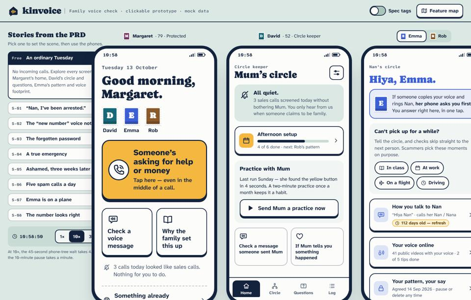

# Roast: KinVoice v1 → v2

I reviewed v1 the way a skeptical design lead would, against the PRD's own rules: an 80-year-old who is panicking and has shaky hands; one decision per screen; never a false reassurance. Every finding below has a v1 screenshot as evidence and the fix that shipped in v2.

v1 commit: `KinVoice prototype v1` · v2 commit: `KinVoice prototype v2`.

---

## 🔥 Critical

### 1. The pause lies

v1 said: *“Nothing can be sent for ten minutes.”* KinVoice can't touch her bank, a gift-card till or a courier at the door. Telling an 80-year-old that the app is blocking payments is exactly the false reassurance PRD §1 forbids. She may start the transfer *because* “the app will stop it”.

**v2:** The pause is her promise, not our brake. The copy now says *“Don't send anything for ten minutes”* and gives her the words to say to the caller: *“I'll ring you back in ten minutes.”* A bank-side hard brake is listed as a partnership hypothesis (PRD §2.3), not as shipped copy.

### 2. Five taps before the kettle
v1 went who → question → money → method → secret → pause, all while a sobbing “grandchild” is on the line. Money and method were two screens for one decision. Nearly every scammer demands secrecy, so the secrecy question collected nothing.

**v2:** Who → family question → *“What are they asking for?”* (one screen, method included) → pause. Secrecy becomes a standing line on the pause screen: *“Whatever they said, you're allowed to tell family.”*

### 3. The most important button is below the fold

**Hang up** sat under a dial, a headline, a callout, the family list and the facts list. *They avoided it* needed a scroll. Someone who doesn't know there is more will never scroll to find it.

**v2:** An action dock is pinned to the bottom of every crisis screen. Content scrolls behind it; the decision never does.

## High

### 4. Three bars of chrome before the first word

The call bar, the yellow pause bar and the “Your family” box took about 190px before *Ask them this*. A status was sitting on top of the task.
**v2:** One header holds the kettle timer and the live family line (*Asking Emma · 0:12*). The full family list appears only on the pause screen.

### 5. No way back
A shaky thumb taps Rob instead of Emma. Rob gets pinged, Emma never does, and there is no undo.
**v2:** Every step has **Back**. Changing who withdraws the wrong person's request and asks the right one.

### 6. A second-hand “no” was treated as gospel

David's *“I know where Emma is”* produced the same screen as Emma's own denial. If David is wrong (S-04: Emma really did crash), Margaret hangs up on a true emergency.
**v2:** Only the named person's own answer is final. A relative's answer reads *“David thinks this isn't Emma”*, Emma keeps being asked, and a later *“Yes, it's me”* from Emma overrides it.

### 7. We promised David would help. Nobody told David
After Emma's *“Yes, it's me”*, Margaret read *“David is sorting out what Emma needs”*. Meanwhile David's phone still showed a stale question card.
**v2:** Emma's yes turns David's card into a hand-off: *“Emma says she needs help — ring Emma”*, together with what the caller asked for.

### 8. “I'll ring Mum now” rang nobody
The family list said *“Is ringing you now”* and nothing rang. Worse, Margaret's *Ring David* button quietly recorded David as having replied.
**v2:** Calls are real in the simulation. David's tap rings Margaret, who sees *“David is ringing — hang up and answer”*. Margaret's *Hang up and ring David* rings David. Calling back on the saved number (P-10) takes one tap.

## Medium

| # | Burn | v2 fix |
|---|---|---|
| 9 | **Two yellow buttons, one job.** During a call, home showed the big button *and* a sticky tab on top of the tiles.  | On home the big button is the tab. The floating tab only appears on other screens. |
| 10 | **Stamps you can't stamp.** The family faces looked tappable and did nothing. | Tap a face to ring that person on their saved number. That builds the call-back habit every day. |
| 11 | **Yellow means five things:** the help button, the pause, “waiting”, warnings and spec tags. | Yellow belongs to help and the pause only. Warnings get a red mark; spec tags become white luggage tags. |
| 12 | **The voice check makes her work for the answer.** Two taps and a long scroll before *Ask David*.  | The comparison runs on open. The headline comes first, the transcript is folded, and the action is docked. |
| 13 | **The banner sits on the card it announces.**  | The banner pushes content down and folds away after a few seconds. |

## Low

| # | Burn | v2 fix |
|---|---|---|
| 14 | **“Well done, Margaret” is how you talk to a child.** It feeds P-14, the fear of being seen as no longer capable. | *“You checked first. That's what the family hoped you'd do.”* |
| 15 | **The header kettle reads as a house.** | Redrawn with an arched handle and a spout. |
| 16 | **The demo didn't fit a laptop.** Phones overlapped at 1440px, didn't reset between stories, and the mobile bar took two lines.  | Stories fold into a drawer below 1600px, phones size to the window, each story remounts every phone, and the mobile bar is one line. |

---

## What v1 got right (kept)
- Family members appear as **postage stamps**, so they read as family, not “users”.
- Outcome headlines **quote family**, never a system verdict: *Emma answered: “That's not me.”*
- The family question is a **recipe card** with the answer to listen for. Nobody has to memorise a password.
- The **kettle dial** is the one memorable thing.
- The **copy guard** runs in the build, so verdict words can't ship.
- No speech pattern exists without that person's **own consent**, given on their own phone.

## Still not solved (v3 backlog)
- The pause is still only a promise. A hard brake needs bank partnerships, which is a hypothesis, not a feature.
- If Emma's phone is gone (lost or smashed), only the family question can carry S-04.
- None of this has been tested with real 80-year-olds. The PRD §17 assumptions stay hypotheses until a moderated study with 5–8 Margarets.
- There's no text-size control yet; we rely on 21px base type and the phone's own settings.
